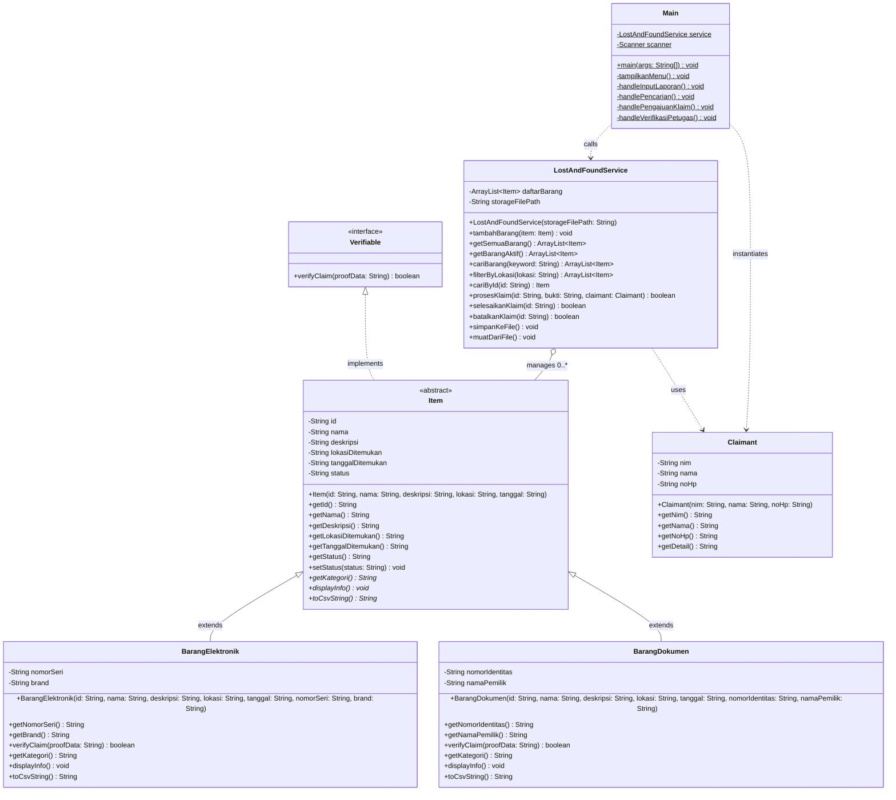

# Arsitektur Sistem & Perancangan Kelas — CampusLostHub

Dokumen ini menjelaskan struktur arsitektur berorientasi objek, kontrak interface, dan relasi antarkelas.

---

## 1. Pola Arsitektur: Layered Separation of Concerns

Aplikasi menerapkan pemisahan tanggung jawab 4 lapis:
1. **Contract Layer (`contract/`):** Antarmuka abstraksi yang mendefinisikan kemampuan objek.
2. **Model Layer (`model/`):** Entitas data inti dengan enkapsulasi ketat.
3. **Service / Control Layer (`service/`, `storage/`):** Pemrosesan logika bisnis, manipulasi `ArrayList`, dan manajemen persistensi file CSV.
4. **Presentation Layer (`view/`, `Main.java`):** Antarmuka pengguna (Console / Java Swing) dan penanganan input/output.

## 1.1 Pembagian Modul dan Kepemilikan Role

| Role | Pemilik modul | Tanggung jawab |
|---|---|---|
| Aris Kurniawan | `contract/`, `model/`, `exception/` domain | Kontrak OOP, entity, inheritance, polymorphism, validasi status, dan verifikasi klaim |
| Sabilu Rosyada (Bilu) | `service/`, `storage/`, `exception/` | `LostAndFoundManager`, `ArrayList<Item>`, serialisasi/deserialisasi CSV, custom exception, dan integritas file |
| Intan Kusumaningarum | `model/Claimant.java`, `view/`, `Main.java` | Class `Claimant`, menu, form, validasi input UI, navigasi alur, pengujian fungsional, dan video demo |

Ketergantungan modul berjalan satu arah:

```text
Aris: contract/model/exception
          ↓
Bilu: service/storage
          ↓
Intan: view/Main
```

`view` tidak membaca CSV langsung. `service` tidak mengakses field private model. Perubahan pada kontrak model harus disepakati sebelum modul service dan UI menyesuaikan.

## 1.2 Struktur Modular Target

```text
src/id/ac/pens/psdku/campuslosthub/
├── Main.java
├── contract/
│   └── Verifiable.java
├── model/
│   ├── Item.java
│   ├── BarangElektronik.java
│   ├── BarangDokumen.java
│   └── Claimant.java
├── exception/
│   ├── InvalidClaimException.java
│   ├── ItemNotFoundException.java
│   └── StorageException.java
├── service/
│   └── LostAndFoundManager.java
├── storage/
│   └── CsvStorage.java
└── view/
    ├── ConsoleView.java
    ├── InputValidator.java
    └── TableFormatter.java
```

---

## 2. Diagram Kelas UML (Mermaid Class Diagram)



---

## 3. Rincian Kontrak Kelas

### 3.1. Interface `Verifiable`
* **Package:** `id.ac.pens.psdku.campuslosthub.contract`
* **Method:** `boolean verifyClaim(String proofData)`
* **Tujuan:** Menstandarkan method verifikasi kepemilikan. Setiap kelas turunan `Item` memiliki implementasi verifikasi yang independen tanpa saling mencampuri logika satu sama lain.

### 3.2. Abstract Class `Item`
* **Package:** `id.ac.pens.psdku.campuslosthub.model`
* **Konstanta Status:**
  * `STATUS_TERSEDIA = "TERSEDIA"`
  * `STATUS_PROSES_KLAIM = "PROSES_KLAIM"`
  * `STATUS_SELESAI = "SELESAI"`
* **Prinsip Encapsulation:** Seluruh mutasi `status` melalui method `setStatus(String status)` dengan validasi transisi status sah.

### 3.3. Subclass `BarangElektronik`
* **Logika Polimorfik:** `verifyClaim(proofData)` melakukan pencocokan terhadap `nomorSeri` secara *case-insensitive* dan membersihkan karakter spasi/tanda hubung.

### 3.4. Subclass `BarangDokumen`
* **Logika Polimorfik:** `verifyClaim(proofData)` melakukan pencocokan terhadap `nomorIdentitas` (NIM/NIK) atau kecocokan nama pemilik.

### 3.5. Service Class `LostAndFoundService`
* **Package:** `id.ac.pens.psdku.campuslosthub.service`
* **Tanggung Jawab:** Bertindak sebagai Controller data, memanipulasi `ArrayList<Item>`, melakukan operasi pencarian berantai, memicu operasi file I/O, serta melempar custom exception (`ItemNotFoundException`, `InvalidClaimException`).
